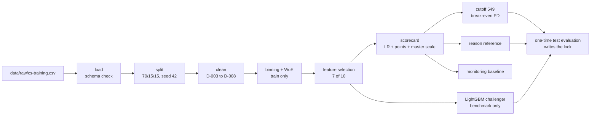
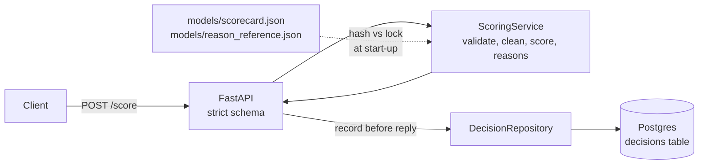
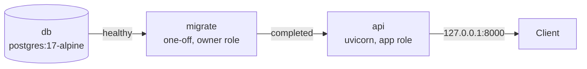

# Architecture

The project has two halves that share one codebase and one set of fitted files:

1. **Offline pipeline.** Turns the raw Kaggle file into a tested, fingerprinted scorecard.
2. **Online scoring service.** Loads exactly that scorecard and issues audited approve/decline decisions over HTTP.

Decision numbers (D-0xx) refer to [decisions.md](decisions.md).

## 1. Offline pipeline



| Stage | Module | Output |
|---|---|---|
| Load and schema check | `scorecard.data.load` | DataFrame with the 10 bureau fields and the target |
| Audit (read-only) | `scorecard.data.audit` | `reports/data_audit.md` |
| Split | `scorecard.data.split` | train / valid / test, stratified on the target |
| Clean | `scorecard.data.clean` | one pure `clean()` function, reused by the API |
| Binning, WoE and IV | `scorecard.features.binning`, `.woe`, `.iv`, `.encoder` | `models/woe_encoder.json` |
| Feature selection | `scorecard.features.selection` | `models/selected_features.json` |
| Scorecard | `scorecard.models.scorecard` | `models/scorecard.json` (encoder, points, master scale) |
| Challenger | `scorecard.models.challenger` | `models/challenger_lgbm.txt` |
| Cutoff | `scorecard.evaluation.cutoff` | `reports/cutoff_strategy.md` |
| Reason codes | `scorecard.explain.reason_codes` | `models/reason_reference.json` |
| Monitoring | `scorecard.evaluation.psi` | `models/monitoring_baseline.json` |
| Test evaluation | `scorecard.pipelines.evaluate` | `reports/test_evaluation.md` and `.lock.json` |
| End-to-end rebuild | `scorecard.pipelines.train` | all of the above, checked against the lock |

**Rules this half enforces**

- **No leakage.** The data is split before anything is fitted. Bins, WoE, feature selection, model coefficients, the master scale and the reason reference are all learned on **train**. Choices are made on **valid**. **Test** is scored exactly once.
- **The test lock.** That single test run records the SHA-256 of every frozen input in `reports/test_evaluation.lock.json`. A second run needs `--force` and is recorded as a forced re-run (D-020).
- **Reproducibility.** `python -m scorecard.pipelines.train` rebuilds every artifact from the raw CSV and compares the hashes with the lock. A match proves the shipped model is the one that was tested (D-022). Seeds are fixed in `configs/config.yaml`.
- **Readable artifacts.** Models are stored as JSON (and LightGBM's native text format), not pickles. They can be reviewed and diffed, and they are safe to load.

## 2. Online scoring service



| Layer | Module | Responsibility |
|---|---|---|
| HTTP | `scorecard.api.main`, `routes/score.py`, `routes/health.py` | Request parsing, error mapping, probes |
| Contract | `scorecard.api.schemas` | Strict Pydantic models that use the bureau field names |
| Scoring core | `scorecard.api.scoring` | Validation, the shared `clean()`, score, PD, decision, reason codes |
| Persistence | `scorecard.api.db` | Engine, append-only repository, start-up schema check |
| Migrations | `migrations/` (Alembic) | The only way the schema changes |

**Request path for `POST /score`**

1. **Schema validation (Pydantic).** The schema is strict:
   - no string-to-number coercion;
   - booleans are not accepted as numbers;
   - unknown fields are rejected, so a typo cannot pass as "income not reported";
   - Infinity and NaN are rejected;
   - age must be at least 18.

   Errors return **422** without echoing the applicant's values.
2. **The core validates again.** Batch jobs and the future Streamlit app call the core directly, so the HTTP schema is not the only guard (defence in depth).
3. **Same `clean()` as training.** The service imports the training function rather than a copy of it. A skew test checks that the service and the offline pipeline give identical scores on every validation row.
4. **Score, decision and reasons.** The core computes:
   - the integer score;
   - the calibrated PD from the master scale;
   - approve if PD <= break-even PD (score cutoff 549);
   - up to 4 reason codes, for declines only.
5. **Audit record before reply.** The decision, the raw inputs, the cutoff and the `model_version` are written to the `decisions` table. If the write fails, the API returns **503** with `Retry-After` and **issues no decision** (fail closed, D-025).

**Start-up checks (fail fast, D-024)**

- The two served files are hashed and compared with the **first** run in the test lock. If they don't match, the service refuses to start (`ArtifactMismatch`).
- The database must be reachable and at the latest Alembic revision (`SchemaNotCurrent`). The application never creates or alters tables itself.
- The model is loaded once at start-up, not once per request.

**Endpoints**

| Method and path | Purpose |
|---|---|
| `POST /score` | Score one applicant and return the decision with its `decision_id` |
| `GET /health` | Liveness: the process is up and the model is loaded (returns `model_version` and `cutoff`) |
| `GET /ready` | Readiness: the database is reachable, so decisions can be recorded |
| `GET /docs`, `/openapi.json` | Generated API contract |

## 3. Data model: the audit table

The `decisions` table holds one row per issued decision. The table is **append-only**: no code path updates or deletes a row, and in Postgres the API's database role has only `SELECT` and `INSERT`.

| Column | Meaning |
|---|---|
| `id` | UUID4, returned to the client as `decision_id` |
| `created_at` | UTC timestamp (indexed) |
| `model_version` | First 12 hex characters of the scorecard's SHA-256 (indexed) |
| `cutoff`, `score`, `pd`, `decision` | The decision, with CHECK constraints on `decision` and `pd` |
| `reasons` | Reason codes as issued (JSON) |
| `inputs` | The 10 raw fields exactly as received (JSON), so any decision can be re-scored for a dispute |

## 4. Deployment



- **Image.** A two-stage `python:3.12-slim` build from `requirements/serve.lock`, which is resolved inside Linux. The container runs as a non-root user (uid 10001), and the model files are read-only. An allow-list `.dockerignore` keeps data, secrets and tests out of the image.
- **Compose.** `db` must be healthy before the `migrate` job runs. `migrate` must finish successfully before `api` starts. The API is bound to localhost only.
- **Least privilege.** Two database roles:
  - `scorecard_owner` runs migrations (DDL).
  - `scorecard_app`, used by the API, can only `SELECT` and `INSERT`.

  A smoke test checks that `UPDATE` is refused.
- **Secrets.** Passwords live in `.env`, which is git-ignored and blocked by a pre-commit hook. `.env.example` is the template.

## 5. Quality gates

| Gate | Where | What it checks |
|---|---|---|
| pre-commit | every `git commit` | ruff lint and format, YAML/TOML syntax, whitespace and line endings, private keys, large files, no `data/` files, no `.env` |
| pytest | every `git push` and CI | unit, API and integration tests. A missing model **fails** in CI instead of skipping |
| CI `checks` job | GitHub Actions | the same hooks and tests on a clean Linux runner |
| CI `docker` job | GitHub Actions | builds the stack, runs the smoke test and checks the database privileges |

The CI actions are pinned by commit SHA, and the workflow token is read-only. `.gitattributes` stores `models/` and `reports/` byte-for-byte, so the hashes in the lock stay valid in every clone (D-027).

## 6. Repository layout

```
configs/            config.yaml: seeds, thresholds, business inputs, paths
src/scorecard/
  data/             load, audit, clean, split
  features/         binning, WoE, IV, encoder, selection
  models/           scorecard, challenger
  evaluation/       metrics, calibration, cutoff, PSI/CSI
  explain/          reason codes
  pipelines/        train (rebuild), evaluate (one-time test run)
  api/              scoring core, FastAPI app, schemas, routes, db
migrations/         Alembic revisions
models/             fitted artifacts (JSON / LightGBM text), fingerprinted
reports/            generated reports and the test lock
tests/              unit/, api/, integration/
docker/, Dockerfile, docker-compose.yml, requirements/serve.lock
docs/               this file, assumptions, business case, decision log
```
